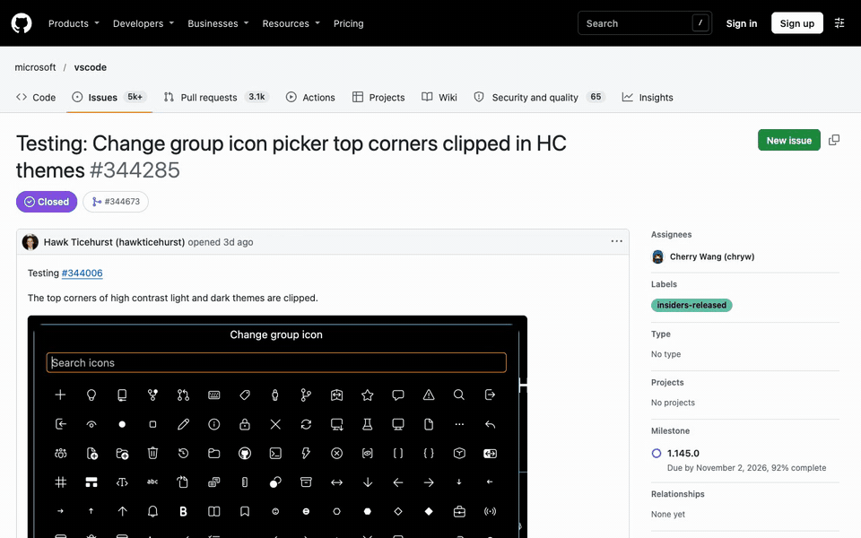
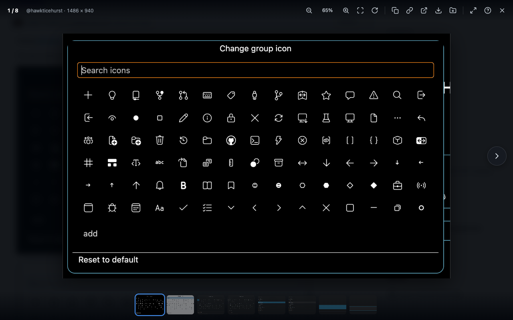
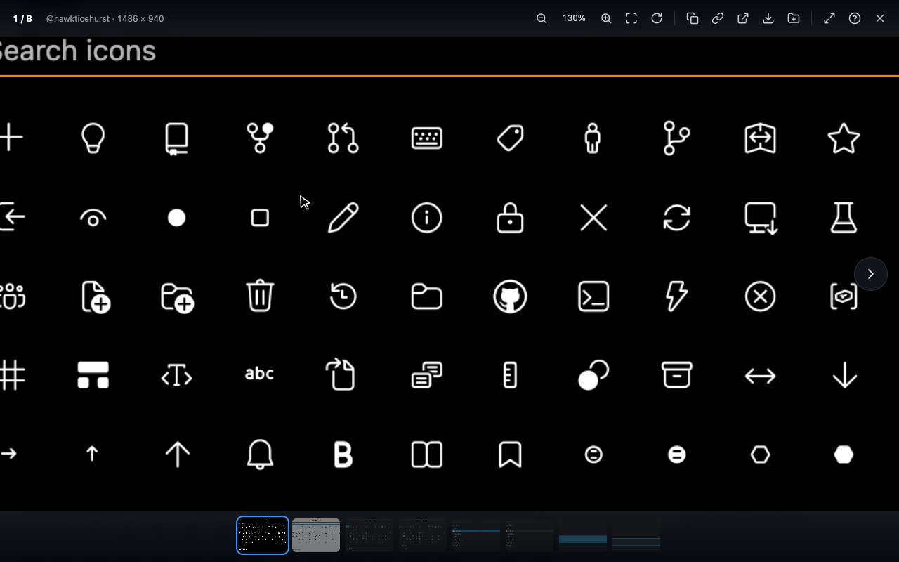
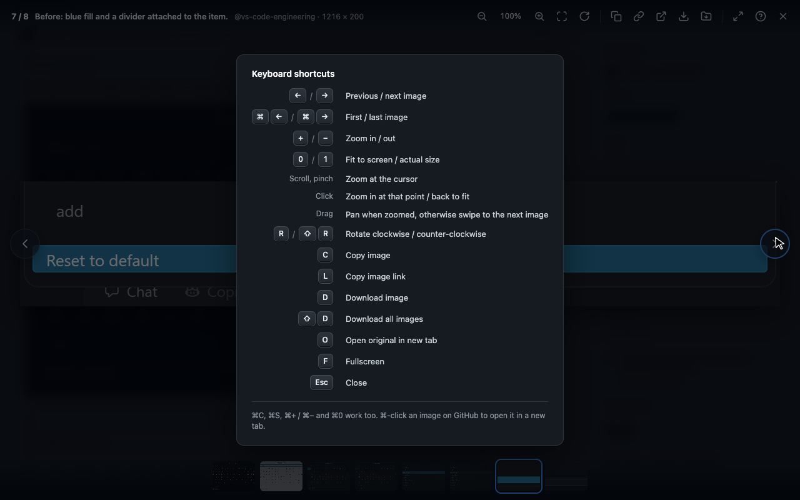
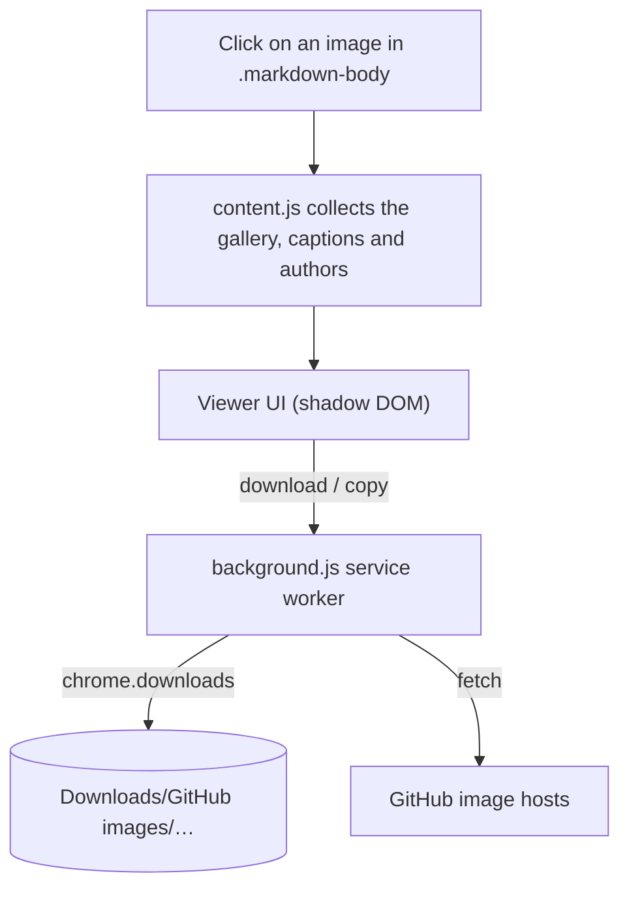

<p align="center">
  
</p>

<h1 align="center">Image Viewer for GitHub</h1>

<p align="center">
  <b>Click a screenshot in a pull request. Stay on the page.</b><br>
  A fast, keyboard-friendly image viewer for GitHub PRs, issues, comments and READMEs.
</p>

<p align="center">
  <a href="https://github.com/AyushKaithwas/github-image-viewer/actions/workflows/test.yml"></a>
  
  
  <a href="LICENSE"></a>
</p>

<p align="center">
  
</p>

---

GitHub opens every image in a new tab. Reviewing a pull request with twenty screenshots means twenty tabs, and losing your place in the conversation each time. This extension opens images in a viewer on top of the page instead, with everything you'd expect from a photo viewer.

## Features

- **Browse the whole page.** Every image in the PR or issue, in page order, with a thumbnail strip, arrow keys, buttons, and swipe or two-finger trackpad gestures. When a README thumbnail links to a full-size file, the viewer shows the full-size one.
- **Zoom where you click.** Click a spot to zoom into it, scroll or pinch for fine control, drag to pan. Text in screenshots stays sharp at any zoom level.
- **Know what you're looking at.** Captions come from the table heading above the screenshot (the usual `Before | After` layout), a label row, or alt text. The comment author and the image's real pixel size are shown alongside.
- **Copy and save.** Copy the image to the clipboard as PNG, copy its link, or download it at full size with the right file extension. *Download all* saves every image into a folder named after the PR, numbered and named after their captions.
- **Feels native.** The image grows out of its thumbnail and shrinks back into it on close. ⌘ shortcuts on macOS, Ctrl on Windows and Linux. ⌘/Ctrl-click still opens an image in a new tab.
- **Stays out of the way.** Badges, emoji, avatars, images inside collapsed `<details>`, and images that link somewhere else (like a CI badge) are left alone.

<table>
  <tr>
    <td></td>
    <td></td>
    <td></td>
  </tr>
  <tr>
    <td align="center">Gallery with thumbnails</td>
    <td align="center">Click to zoom</td>
    <td align="center">Press <kbd>?</kbd> for shortcuts</td>
  </tr>
</table>

## Install

The extension isn't on the Chrome Web Store yet, so install it from source:

1. [Download this repository as a ZIP](https://github.com/AyushKaithwas/github-image-viewer/archive/refs/heads/main.zip) and unzip it, or `git clone` it.
2. Open `chrome://extensions` and turn on **Developer mode** (top right).
3. Click **Load unpacked** and choose the **`extension`** folder.
4. Reload any GitHub tabs you already had open.

Other Chromium browsers (Edge, Brave, Arc) can load it the same way. Tested in Chrome.

## Keyboard shortcuts

| Action | macOS | Windows / Linux |
| --- | --- | --- |
| Previous / next image | <kbd>←</kbd> <kbd>→</kbd> | <kbd>←</kbd> <kbd>→</kbd> |
| First / last image | <kbd>⌘</kbd><kbd>←</kbd> <kbd>⌘</kbd><kbd>→</kbd> | <kbd>Home</kbd> <kbd>End</kbd> |
| Zoom in / out | <kbd>+</kbd> <kbd>−</kbd> or <kbd>⌘</kbd><kbd>+</kbd> <kbd>⌘</kbd><kbd>−</kbd> | <kbd>+</kbd> <kbd>−</kbd> or <kbd>Ctrl</kbd><kbd>+</kbd> <kbd>Ctrl</kbd><kbd>−</kbd> |
| Fit to screen / actual size | <kbd>0</kbd> / <kbd>1</kbd> | <kbd>0</kbd> / <kbd>1</kbd> |
| Zoom at a point | Click or double-click the image | Click or double-click the image |
| Rotate | <kbd>R</kbd>, <kbd>⇧</kbd><kbd>R</kbd> | <kbd>R</kbd>, <kbd>Shift</kbd><kbd>R</kbd> |
| Copy image | <kbd>C</kbd> or <kbd>⌘</kbd><kbd>C</kbd> | <kbd>C</kbd> or <kbd>Ctrl</kbd><kbd>C</kbd> |
| Copy image link | <kbd>L</kbd> | <kbd>L</kbd> |
| Download image | <kbd>D</kbd> or <kbd>⌘</kbd><kbd>S</kbd> | <kbd>D</kbd> or <kbd>Ctrl</kbd><kbd>S</kbd> |
| Download all images | <kbd>⇧</kbd><kbd>D</kbd> | <kbd>Shift</kbd><kbd>D</kbd> |
| Open original in new tab | <kbd>O</kbd> | <kbd>O</kbd> |
| Fullscreen | <kbd>F</kbd> | <kbd>F</kbd> |
| Shortcut help | <kbd>?</kbd> | <kbd>?</kbd> |
| Close | <kbd>Esc</kbd> or click the background | <kbd>Esc</kbd> or click the background |

## How it works



The whole extension is two plain JavaScript files with no build step and no dependencies. A few details that make it work well on GitHub:

- **It never fights GitHub's own handlers.** A capture-phase listener on `window` sees the click before GitHub does. Modifier clicks and middle clicks pass straight through.
- **It survives navigation.** GitHub swaps `<body>` when you move between pages, so the viewer is attached to `<html>` and closes itself on navigation.
- **It's isolated.** The UI lives in a shadow root, so GitHub's CSS can't affect it and its CSS can't leak into GitHub.
- **Zoomed images stay sharp.** The viewer resizes the `` itself instead of scaling it with `transform: scale()`, so the browser redraws it at the real size.
- **Downloads work for private repos.** `chrome.downloads` sends your GitHub session cookies, so private attachments download like public ones. GitHub's attachment URLs have no file extension, so the worker picks the final filename in `onDeterminingFilename`, once Chrome knows the file type.
- **Copying works despite CORS.** GitHub's image hosts don't allow cross-origin reads from a page, so the service worker fetches the bytes. The page converts them to PNG with `OffscreenCanvas` and writes them to the clipboard.

## Privacy

Everything happens in your browser, and the first time you click an image the viewer explains what it reads and asks you to agree. The developer receives no data, and there are no analytics, tracking or remote code. The only requests the extension makes are for the images themselves: the ones already on the page, the full-size file when a thumbnail links to one on GitHub, and the image's file when you copy or download it. The full [privacy policy](PRIVACY.md) has the details.

| Permission | Why |
| --- | --- |
| `downloads` | Save images with sensible names and folders |
| `storage` | Remember that you agreed to the one-time privacy notice |
| `github.com` | Run the viewer on GitHub pages, and fetch GitHub-hosted images for **Copy image** |
| `raw`, `camo`, `private-user-images`, `user-images`, `media`, `gist` `.githubusercontent.com` | Fetch image bytes from GitHub's image servers for **Copy image** |

## Development

```bash
npm install
npm run setup         # downloads Playwright's Chromium
npm test              # end-to-end + download naming tests (headless)
npm run test:live     # visible Chrome against a real public GitHub issue
npm run demo          # re-records docs/demo.gif and the screenshots (needs ffmpeg)
npm run package       # zips extension/ for the Chrome Web Store
npm run store-assets  # renders the store's promo images into store/
```

The tests load the real extension into Chromium and drive it with mouse and keyboard input:

- **`tests/e2e.mjs`** serves copies of GitHub's PR and README markup at `github.com` and checks 64 behaviours, from captions and zoom anchoring to keyboard focus, clipboard contents and download requests.
- **`tests/downloads.mjs`** launches Chromium without automation owning downloads, to check the files really land on disk with the right names and extensions.
- **`tests/live.mjs`** runs the same kind of checks on a real GitHub issue.

```
extension/           the extension (load this folder in chrome://extensions)
  manifest.json
  src/content.js     gallery detection and the viewer
  src/background.js  downloads and image fetches
tests/               Playwright end-to-end tests and fixtures
scripts/             icon renderer, PNG encoder, demo recorder
docs/                README media
```

## Related

If you'd rather use a userscript, [GitHub Image Lightbox](https://greasyfork.org/scripts/591189-github-image-lightbox) and [GitHub Ultimate Lightbox Gallery](https://greasyfork.org/scripts/585774-github-ultimate-lightbox-gallery) on Greasy Fork do something similar through Tampermonkey or Violentmonkey.

## License

[MIT](LICENSE) © Ayush Kaithwas

Image Viewer for GitHub is an independent project, not affiliated with or endorsed by GitHub, Inc.
